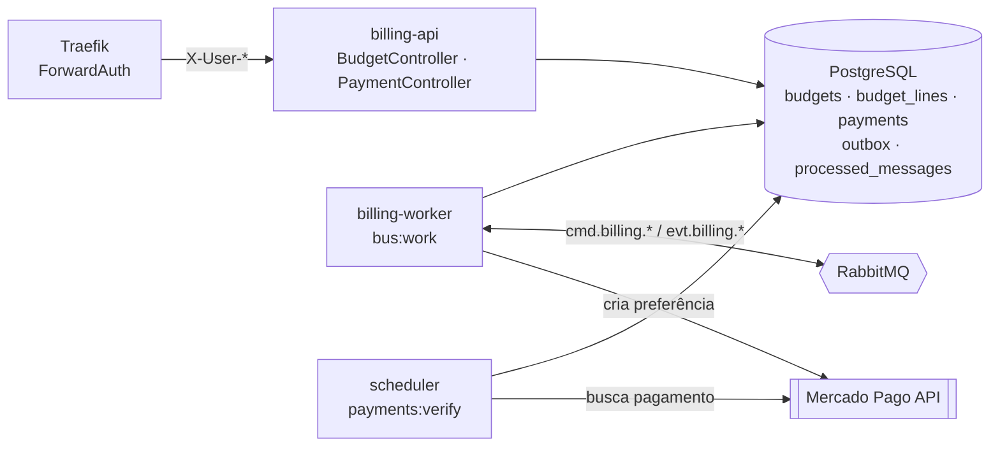

# 15SOAT-Fase1-billing — Billing Service

Microsserviço de **orçamentos e pagamentos** da Workshop OS (Fase 4 — SOAT/FIAP).

- Gera o orçamento quando a saga pede (`cmd.billing.create_budget`) e o envia para aprovação do cliente.
- Registra a aprovação ou rejeição (`POST /api/v1/budgets/{id}/approve|reject`) e publica `evt.billing.budget_*`.
- Abre o pagamento no **Mercado Pago** (Checkout Pro, credenciais de teste) e confirma por polling (`payments:verify`).
- A confirmação atualiza a OS via `evt.billing.payment_confirmed`.

Arquitetura geral, saga e decisões: repo
[15SOAT-Fase1](https://github.com/CandidoRPNeto/15SOAT-Fase1) (RFC-004, ADR-010..015).

## Arquitetura do serviço



| Camada | Conteúdo |
|---|---|
| `app/Domain/Billing` | `BillingMessage`, `BudgetStatus`, `PaymentStatus` |
| `app/Application/Billing` | `CreateBudget`, `VoidBudget` (compensação), `RequestPayment`, `DecideBudget`, `VerifyPayment`, `BillingMessageRouter` |
| `app/Application/Ports` | `PaymentGateway`, `MessagePublisher`, `MessageConsumer`, `MessageRouter` |
| `app/Infrastructure` | `MercadoPagoPaymentGateway`, `OfflinePaymentGateway`, adapters RabbitMQ |

Contrato das mensagens: [`docs/asyncapi.yaml`](docs/asyncapi.yaml).

## Tecnologias

Laravel 13 · PHP 8.4 · PostgreSQL 16 · RabbitMQ (php-amqplib) · Mercado Pago REST API · L5-Swagger · Datadog APM · Docker · Kubernetes (kind) · GitHub Actions · SonarCloud.

## Executar

```bash
composer install && cp .env.example .env && php artisan key:generate
php artisan test                              # SQLite :memory:, PAYMENT_GATEWAY=offline
RABBITMQ_TEST_HOST=127.0.0.1 php artisan test # + integração com RabbitMQ real
```

Deploy no Kubernetes (cluster kind; plataforma em
[15SOAT-Fase1-kubernetes](https://github.com/CandidoRPNeto/15SOAT-Fase1-kubernetes)):

```bash
export KUBECONFIG=~/.kube/workshop-os-config
scripts/deploy-kind.sh ghcr.io/candidorpneto/15soat-fase1-billing:<tag>
```

Manifests: `k8s/` (namespace `billing`):
- `billing-api` + HPA;
- `billing-worker` (`bus:work` + `schedule:work`);
- StatefulSet `billing-postgres`;
- Job `billing-migrate`;
- Ingress com ForwardAuth.

Mercado Pago:
- coloque `MERCADOPAGO_ACCESS_TOKEN=TEST-...` em `~/.workshop-os/secrets/billing.env`;
- defina `PAYMENT_GATEWAY=mercadopago`;
- rode `scripts/bootstrap-secrets.sh` (repo kubernetes);
- **nunca commite o token**.

## CI/CD

`.github/workflows/ci-cd.yml`:
1. **test** — PHPUnit, cobertura ≥ 80%, RabbitMQ real;
2. **quality** — Pint + SonarCloud quality gate;
3. **build** — imagem no GHCR;
4. **deploy** — runner self-hosted → kind, só em push na `main`.

A `main` é protegida: PR obrigatório e checks `test` e `quality`.

## API

- Swagger: http://localhost:30080/billing/api/documentation
- Rotas (via gateway, com token do OS Service): `GET /api/v1/budgets`, `GET /api/v1/budgets/{id}`, `POST /api/v1/budgets/{id}/approve|reject`, `GET /api/v1/payments`, `GET /api/v1/payments/{id}`, `POST /api/v1/payments/{id}/verify`.

## Cobertura

Local, sem broker: ~85%. No CI, com RabbitMQ, os adapters também são cobertos. Relatório: artefato `coverage` de cada execução do workflow e SonarCloud.
